# 📸 Awesome Desktop RAW Photo Editing

  

  
  
  
  
  
  
  

---

> 🎯 **A comprehensive, SEO-optimized, curated directory of world-class desktop RAW photo editors, non-destructive image processors, GPU-accelerated demosaicing engines, and studio-grade color management suites.**

Whether you are a commercial studio photographer processing thousands of mirrorless camera frames, a fine-art printmaker demanding colorimetric precision, or a privacy-conscious creator seeking 100% offline open-source darkrooms, this directory tracks both flagship commercial creative suites and powerful community-driven projects.

---

## 📑 Table of Contents

- [📊 Sector Overview & Market Dynamics](#-sector-overview--market-dynamics)
- [💼 Commercial & SaaS Platforms](#-commercial--saas-platforms)
- [⚡ Open-Source GitHub Projects](#-open-source-github-projects)
- [🧩 Architecture & Workflow Recommendations](#-architecture--workflow-recommendations)
- [⭐ Star History](#-star-history)
- [🤝 Support](#-support)
- [💡 How to Contribute](#-how-to-contribute)
- [⚠️ Disclaimer](#-disclaimer)

---

## 📊 Sector Overview & Market Dynamics

The global photo editing software market is estimated at approximately **$13 billion to $16 billion** (with specialized desktop and RAW processing accounting for over **$1.5 billion**), expanding steadily at an **8%–10% CAGR** fueled by generative AI enhancements, sensor megapixel expansion, and mirrorless digital camera adoption. 

The sector is **moderately concentrated at the top**—anchored by dominant creative ecosystems like Adobe Lightroom and platform-native tools like Apple Photos—while maintaining a vibrant, fragmented tier of specialized independent software vendors (Capture One, DxO, Skylum) and deeply dedicated open-source developers (darktable, RawTherapee, LibRaw) that cater to demanding studio workflows, color scientists, and privacy-focused local computing.

---

## 💼 Commercial & SaaS Platforms

The table below compiles industry-leading commercial desktop applications, ranked in descending order by developer valuation and financial scale:

| Product | Developer / Parent Company | Valuation / Revenue Scale | Pricing (Starting Tier) | Free Tier / Trial Limits | Description |
| :--- | :--- | :--- | :--- | :--- | :--- |
| **[Apple Photos](https://www.apple.com/macos/photos/)** | Apple Inc. | ~$3.5T market cap / ~$391B annual revenue | Free (bundled with macOS / iOS hardware) | Free forever with hardware purchase (includes 5 GB free iCloud storage for cross-device sync) | Built-in macOS photo application featuring non-destructive RAW editing, system machine learning, and native ecosystem synchronization. |
| **[Adobe Lightroom Classic](https://www.adobe.com/products/photoshop-lightroom-classic.html)** | Adobe Inc. | ~$220B market cap / ~$21.4B annual revenue | $9.99/mo (Photography Plan, billed annually; includes Lightroom Classic, Lightroom, Photoshop & 20GB cloud storage) | 7-day free trial (full-featured access to Lightroom Classic and Photoshop with credit card signup) | Industry-standard desktop RAW developer and cataloging application with non-destructive editing, AI masking, and deep Photoshop interoperability. |
| **[Affinity Photo 2](https://affinity.serif.com/photo/)** | Canva / Serif | ~$32B Canva valuation / ~$2.5B annual revenue | $0 (Core software free to download and use with Canva account; Canva Pro AI integration starts at $15/mo or $120/yr) | Free forever core software tier (unlimited non-destructive RAW editing and export; Canva Pro required only for generative AI tools) | Professional photo editing suite with full RAW development and raster graphics capabilities, integrated with Canva's ecosystem. |
| **[Corel AfterShot Pro](https://www.coreldraw.com/en/product/aftershot-pro/)** | Corel Corporation (KKR) | ~$1B+ valuation / ~$180M–$200M annual revenue | $79.99 (one-time perpetual license) | 30-day free trial (fully functional RAW processing and cataloging workflow without credit card upfront) | High-speed RAW photo workflow application prioritizing high-volume batch processing and multi-threaded catalog management. |
| **[Capture One Pro](https://www.captureone.com/)** | Capture One A/S (Axcel) | ~$215M Phase One spin-off valuation / ~€24M (~$28M) annual revenue | $17.99/mo (billed annually) or $299 one-time perpetual license | 7-day free trial (unrestricted full-feature access to Pro tethering and color grading; requires account creation) | Studio-grade RAW processor celebrated for unmatched color fidelity, professional tethered shooting, and layer-based grading. |
| **[Skylum Luminar Neo](https://skylum.com/luminar)** | Skylum Software | Bootstrapped / ~$18M–$20M annual revenue | $9.95/mo (billed annually at $119/yr) or $199 one-time perpetual license | 7-day free trial (full access to core workspace and AI enhancement tools; requires email submission) | AI-centric RAW editing suite featuring automated relighting, sky replacement, composition tools, and non-destructive layering. |
| **[DxO PhotoLab](https://www.dxo.com/dxo-photolab/)** | DxO Labs | Privately held (~$36M total funding) / ~$16.8M annual revenue | $139 (one-time perpetual license, Essential edition) or $229 (Elite edition) | 30-day free trial (full access to flagship Elite edition including DeepPRIME AI noise reduction; no credit card required) | Precision RAW converter renowned for camera/lens optical aberration correction and DeepPRIME AI demosaicing/denoising. |
| **[ACDSee Photo Studio Professional](https://www.acdsee.com/)** | ACD Systems | Privately held / ~$8M–$15M annual revenue | $7.99/mo (ACDSee 365 subscription) or $119.99 one-time perpetual license | 15-day free trial (full unwatermarked access to all RAW processing and DAM organization tools) | Robust digital asset management and RAW processing suite delivering parametric editing and comprehensive metadata controls. |
| **[Exposure X7](https://exposure.software/)** | Exposure Software | Bootstrapped / ~$5M–$10M annual revenue | $129 (one-time perpetual standalone/plugin license) | 30-day free trial (fully functional non-destructive RAW editing, film presets, and masking without watermarks) | Creative RAW developer centered around analog film emulation, responsive browsing, and selective brush masking. |
| **[ON1 Photo RAW](https://www.on1.com/products/photo-raw/)** | ON1 Software | Privately held / ~$2M–$5M annual revenue | $7.99/mo (billed annually at $89.99/yr) or $99.99 one-time perpetual license | 30-day free trial (fully functional standalone/plugin suite without watermarks or credit card requirements) | Comprehensive all-in-one RAW photo editor and organizer packing AI segmentation, masking, and portrait retouching tools. |

---

## ⚡ Open-Source GitHub Projects

Explore the richest open-source ecosystem in imaging software. Projects are sorted in **descending order by GitHub star count**, featuring live social star badges that link directly to each repository's stargazers page:

1. **[immich](https://github.com/immich-app/immich)**   
   🚀 Ultra-fast self-hosted photo and video backup solution with native camera RAW decoding, machine learning facial recognition, vector search, and multi-user web/mobile access.

2. **[darktable](https://github.com/darktable-org/darktable)**   
   🌟 Professional open-source photography workflow application and virtual lighttable/darkroom. Implements a modern scene-referred color pipeline (filmic/sigmoid tone-mapping), full color management, tethering support, and non-destructive 32-bit floating-point processing.

3. **[GIMP](https://github.com/GNOME/gimp)**   
   🎨 The quintessential open-source image manipulation program. Seamlessly integrates with darktable and RawTherapee plugins as external RAW development backends for high-bit-depth image retouching.

4. **[RawTherapee](https://github.com/RawTherapee/RawTherapee)**   
   🔬 High-precision cross-platform RAW image processor renowned for advanced demosaicing algorithms (AMaZE, RCD, IGV), CIECAM02 color appearance modeling, dual-demosaicing for noisy sensors, and fine micro-contrast adjustments.

5. **[OpenColorIO](https://github.com/AcademySoftwareFoundation/OpenColorIO)**   
   🎬 Academy Award-winning complete color management solution tailored for visual effects and computer graphics, widely used across professional imaging tools to preserve colorimetry from raw capture to final delivery.

6. **[LibRaw](https://github.com/LibRaw/LibRaw)**   
   📚 Foundational library for reading and extracting sensor RAW data from virtually every digital camera brand (CR2/CR3, NEF, ARW, DNG, RAF). Serves as the core demosaicing backend for dozens of editors and utilities.

7. **[Exiv2](https://github.com/Exiv2/exiv2)**   
   🏷️ Industry-standard C++ library and command-line utility for managing and reading Exif, IPTC, and XMP metadata, embedded color ICC profiles, and camera maker-notes from RAW image files.

8. **[Ansel](https://github.com/aurelienpierreeng/ansel)**   
   ⚡ Lean, refined darktable fork designed by Aurélien Pierre. Focuses on an uncompromising scene-referred workflow, simplified user interface, removal of obsolete modules, and pure physics-based color rendering.

9. **[digiKam](https://github.com/KDE/digikam)**   
   📂 Enterprise-grade digital asset management (DAM) application with native 16-bit image editing, LibRaw-powered raw decoding, hierarchical tagging, geolocation mapping, and deep facial recognition.

10. **[Filmulator](https://github.com/CarVac/filmulator-gui)**   
    🎞️ Innovative RAW processor that computationally models the physics of silver halide photographic emulsion development, delivering natural highlight roll-off, film-like local contrast, and organic halation.

11. **[Luminance HDR](https://github.com/LuminanceHDR/LuminanceHDR)**   
    🌅 Specialized open-source high-dynamic-range workflow application providing synthetic HDR exposure merging, tonemapping operators (Mantiuk, Durand, Fattal), and direct camera RAW file ingestion.

12. **[vkdt](https://github.com/hanatos/vkdt)**   
    🚀 Experimental next-generation Vulkan-powered node-based RAW processing engine designed for ultra-high-speed real-time previewing, 8K+ rendering throughput, and GPU compute efficiency.

13. **[ART (Another RawTherapee)](https://github.com/artpixls/ART)**   
    🎯 Modernized fork of RawTherapee introducing localized vector/parametric masking, ACES/OpenColorIO support, simplified tone curves, and enhanced usability without sacrificing colorimetric depth.

14. **[Rawspeed](https://github.com/darktable-org/rawspeed)**   
    🏎️ High-performance camera RAW file decoding library utilized by darktable, engineered from the ground up for SIMD vectorized decompression and fuzz-tested safety.

15. **[MLV App](https://github.com/ilia3101/MLV-App)**   
    🎥 Dedicated cross-platform application for processing Magic Lantern RAW video (MLV) and cinema DNG sequences, featuring dual-ISO processing, raw white balance, and film emulations.

16. **[PhotoFlow](https://github.com/aferrero2707/PhotoFlow)**   
    🧩 Non-destructive photographic retouching tool providing an interactive node-based layer graph, complete with color management, VIPS image caching, and linear floating-point precision.

---

## 🧩 Architecture & Workflow Recommendations

Building an end-to-end, zero-cost, privacy-first photography workstation:

- **Core RAW Development**: Use **darktable** or **RawTherapee / ART** as your primary developer for demosaicing, exposure grading, and highlight reconstruction.
- **Cataloging & Asset Management**: Employ **digiKam** for hierarchical taxonomy, facial recognition, and metadata sync; or host **immich** for automated multi-device cloud backups.
- **Custom Tooling & Scripting**: Build bespoke batch conversion scripts using **LibRaw** and **Exiv2**.
- **Film Emulation & Creative Looks**: Explore **Filmulator** for organic film physics and **Luminance HDR** for bracketed exposure merges.

---

## ⭐ Star History

---

## 🤝 Support

If this repository helped you discover the right RAW editing software or streamline your digital photography workflow:

- ⭐ **Star this repository** to help other photographers and developers find it.
- 🍴 **Fork it** to maintain your own workflow notes or contribute improvements.
- 📣 **Share it** with your photography clubs, retouching circles, and developer forums.
- ☕ **Buy me a coffee**: If you would like to support ongoing curation and open-source documentation, please consider sponsoring via the [GitHub Sponsors Dashboard](https://github.com/sponsors/ishandutta2007). Your support is deeply appreciated!

---

## 💡 How to Contribute

1. Fork this repository.
2. Add or update entries in `README.md` maintaining proper markdown tables, badges, or links.
3. Keep descriptions factual, objective, and link directly to official project repositories or homepages.
4. Open a Pull Request with a clear description of your addition.

---

## ⚠️ Disclaimer

- This is a community-curated list maintained for educational, informational, and archival purposes. It is not an official endorsement or legal advice.
- RAW photo processing results, camera profile matching, and color science vary heavily between software engines. Always benchmark software with your own camera sensor profiles and workflow needs.

---

  <b>Crafted with ❤️ for photographers, retouchers, colorists, and open-source imaging creators worldwide.</b>

